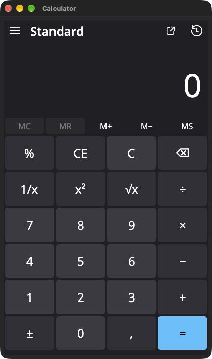
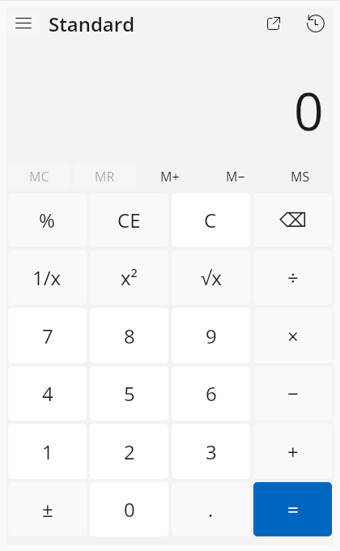

# Calculator

Calculator combines Microsoft's C++ engine with one shared Uno/Skia desktop interface for Windows, macOS, and Linux.
It preserves the original Windows UWP application, Microsoft attribution, and license notices.
The [Microsoft Store edition](https://www.microsoft.com/store/apps/9WZDNCRFHVN5) is a separate distribution.

[](https://github.com/sabino/calculator/actions/workflows/desktop-ci.yml)
[](https://github.com/microsoft/calculator/actions/workflows/action-ci.yml)

## Features

| Mode | Features |
| --- | --- |
| Standard | Basic arithmetic with immediate evaluation |
| Scientific | Precedence, powers, roots, logarithms, and trigonometry menus |
| Programmer | Base conversion, word sizes, bit operations, and bit toggling |
| Date | Gregorian differences and duration shifts |
| Unit converter | Thirteen categories, including dated currency rates |
| Graphing | Equations, parameters, viewport controls, tracing, and supported analysis through the optional portable engine |

History and memory support recall and per-item actions.
The calculation engine retains Microsoft's arbitrary-precision arithmetic implementation.
Currency uses Frankfurter reference rates, with ECB data as fallback and a per-user offline cache.

## Getting started

### Shared desktop application

Use CMake 3.21+, Ninja, Python 3.9+, a C++17 compiler, and .NET SDK 10.0.401.
Windows requires an MSVC developer shell for x64 or ARM64. macOS requires Xcode command line tools.
The Uno SDK and NuGet dependencies are pinned and restored in locked mode.

```sh
cmake -S . -B out/desktop -G Ninja -DCMAKE_BUILD_TYPE=Release
cmake --build out/desktop
ctest --test-dir out/desktop -LE gui --output-on-failure
dotnet out/desktop/desktop/Calculator.dll
```

Publish a self-contained application with `cmake --build out/desktop --target calculator_package`.
See [desktop builds](docs/NativeDesktop.md) for requirements, package paths, GUI checks, and graphing configuration.
The interface lives in `src/Calculator.Desktop`; `CalculatorNative` supplies the portable engine through a C interface.

| macOS | Linux |
| --- | --- |
|  |  |

Desktop controls share the same Uno/Skia interface. Window chrome follows the host platform.
See [application icons](docs/Icons.md) for the owned artwork and packaged formats.

### Original Windows UWP application

The original Windows application remains available through its Visual Studio solution.
It uses the Windows frontend under `src/Calculator`.

Use Visual Studio with the Universal Windows Platform workload, its C++ tools, and the Windows SDK.
Open [Calculator.slnx](src/Calculator.slnx) to build that application.
Its UI tests require [Windows Application Driver](https://github.com/microsoft/WinAppDriver/releases/latest).
See the [original application architecture](docs/ApplicationArchitecture.md) for its components.

## Contributing

Follow the [contributing guidelines](CONTRIBUTING.md).
Report Microsoft Store application issues through [Feedback Hub](https://insider.windows.com/en-us/fb/?contextid=130)
or the [upstream issue tracker](https://github.com/Microsoft/calculator/issues).

## Roadmap

See the [Windows Calculator Roadmap](docs/Roadmap.md) for the upstream project.

### Graphing Mode

The private [portable graphing engine](https://github.com/sabino/graphing-engine) implements the [common graphing API](/src/GraphingInterfaces).
The shared desktop build detects a sibling checkout or accepts `CALCULATOR_GRAPHING_ENGINE_ROOT`.
The original UWP build uses `GraphingEngineRoot` to replace its [mock implementation](/src/GraphingImpl/Mocks).
Microsoft retail graphing behavior remains unverified.

## Diagnostic Data

The original Windows application can send usage data to Microsoft.
Read our [privacy statement](https://go.microsoft.com/fwlink/?LinkId=521839) to learn more.
Development builds disable diagnostic data by default. The `SEND_DIAGNOSTICS` build flag enables it.

## Currency Converter

The shared desktop application downloads dated reference rates from [Frankfurter](https://frankfurter.dev/), with ECB data as fallback.
It identifies the provider and rate dates, and retains valid cached rates during outages.
The original Windows UWP developer build retains its mock currency provider.
Microsoft's retail currency data is not licensed for use in this checkout.

## Reporting Security Issues

Please refer to [SECURITY.md](./SECURITY.md).

## License

Copyright (c) Microsoft Corporation. All rights reserved.

Licensed under the [MIT License](./LICENSE).
