# Desktop Calculator

Calculator uses one Uno/Skia interface on macOS, Linux, and Windows.
Shared WinUI controls replace the AppKit and GTK frontends. Window chrome follows the operating system.
On Windows 11, the native title bar follows Calculator's selected theme and background color.
Microsoft's C++ calculation engine remains behind the portable `CalculatorNative` C interface.
The original Windows UWP solution remains in `src/Calculator.slnx`.

| Source | Responsibility |
| --- | --- |
| `src/Calculator.Desktop/Views` | Shared navigation, calculator, scientific, programmer, date, and graph controls |
| `src/Calculator.Desktop/ViewModel` | Managed native bindings and currency downloads/cache |
| `src/Calculator.Desktop.Tests` | Console checks through the actual native library |
| `src/CalculatorDesktop` | Native model, dates, resources, currency state, and C interface |
| `src/CalcManager` | Microsoft's calculation and unit conversion engine |

## Requirements

| Component | Requirement |
| --- | --- |
| Native compiler | C++17; matching MSVC x64 or ARM64 tools and Windows SDK on Windows |
| Build tools | CMake 3.21+, Ninja, Python 3.9+ |
| .NET | SDK 10.0.401 from `src/Calculator.Desktop/global.json`; patch updates within that feature band are allowed |
| Uno | SDK 6.7.30 and locked NuGet dependencies |
| Desktop | macOS 15+, an X11 Linux session, or Windows |

On macOS, install Xcode command line tools and use Malt for CMake, Ninja, and .NET.
On Windows, use a Visual Studio developer shell for the intended native architecture.
The .NET runtime identifier must match that compiler target.

## Build and check

Run from the repository root:

```sh
cmake -S . -B out/desktop -G Ninja -DCMAKE_BUILD_TYPE=Release \
  -DCALCULATOR_BUILD_UI=ON -DCALCULATOR_BUILD_BRIDGE=ON -DBUILD_TESTING=ON
cmake --build out/desktop
ctest --test-dir out/desktop -LE gui --output-on-failure
```

CMake restores `src/Calculator.Desktop/Calculator.Desktop.csproj` in locked mode after building the native library.
Generated strings and conversion data come from the Windows resources and unit loader.
`desktop_interop` exercises the real C interface from `Calculator.Desktop.Tests`.

GUI checks require a desktop session:

```sh
ctest --test-dir out/desktop -R '^desktop_ui$' --output-on-failure
```

On a headless Linux host, wrap that command with `xvfb-run -a`.
For native checks without .NET, configure with `-DCALCULATOR_BUILD_UI=OFF` and keep the bridge enabled.

## Package and run

```sh
cmake --build out/desktop --target calculator_package
```

| Platform | Application |
| --- | --- |
| macOS | `out/desktop/package/Calculator.app` |
| Linux | `out/desktop/package/Calculator` |
| Windows | `out/desktop/package/Calculator.exe` |

Packages include the .NET runtime, native library, artwork, and license notices.
Keep the package contents together. Quit Calculator before replacing its loaded files.
`CALCULATOR_RUNTIME_ID` selects a matching runtime, such as `win-arm64` or `linux-x64`.
It does not cross-compile the native engine.

macOS packages use ad hoc signing for local execution.
The packaging step relocates native dependencies into the bundle and signs its runtime libraries together.
App entitlements permit .NET JIT execution and loading those bundled libraries.
Malt's dynamically linked Brotli libraries include their redistribution notice.
Use Developer ID signing and notarization through the release process for distribution.
Exercise the actual bundle in smoke-test mode with:

```sh
CALCULATOR_UI_TEST=1 out/desktop/package/Calculator.app/Contents/MacOS/Calculator
```

The environment flag is needed because the bundle launcher does not forward managed command-line arguments.
Linux and Windows executables accept `--smoke-test` directly in an interactive desktop session.
`--mode=standard`, `scientific`, `programmer`, `date`, `graphing`, `settings`, or a converter name such as `speed` or `currency` selects a starting view.
`--scientific` and `--graphing` remain supported. The macOS bundle accepts the same view names through
`CALCULATOR_START_MODE` when launched from a terminal.

Install the published application with:

```sh
cmake --install out/desktop --prefix /absolute/install/prefix
```

macOS installs `Calculator.app` at that prefix. Windows installs the package under `bin`.
Linux installs a `bin/Calculator` launcher, its runtime under `libexec/Calculator`, a desktop entry, and hicolor icons.
Choose a prefix searched by the desktop environment, such as `$HOME/.local`, for Linux menu integration.

## Shared features

| Feature | Behavior |
| --- | --- |
| Standard | Immediate evaluation, percent, reciprocal, square, and square root |
| Scientific | Precedence, powers, roots, logarithms, and advanced trigonometry controls |
| Programmer | Four bases, word sizes, bit operations, and 64 bit toggles |
| History and memory | Recall, per-item removal, and per-slot addition or subtraction |
| Date calculation | Gregorian differences and shifts, from 1601-01-01 through 9999-12-31 |
| Conversion | All 13 categories: 12 fixed-unit categories and dated currency conversion |
| Optional graphing | Equations, parameters, colors, visibility, selection, viewport controls, tracing, and supported analysis |

Fixed-unit calculations and currency cross-rate conversion run in the native engine.
Date addition applies years, months, then days; subtraction reverses that order.
Month ends and leap days clamp according to the shared date model.
Numeric paste respects the selected base and regional separators.
History and memory belong to the application session.
Interface labels are English; bundled engine messages and unit names use the requested locale with English fallback.
Scientific uses the source application's cycling DEG/RAD/GRAD control, F-E toggle, and Trigonometry/Function flyouts below the memory row.
Its seven-row keypad uses Calculator's bundled math glyphs and the source font-size breakpoints when resized.
Navigation keeps its pane measured offscreen and animates one translation, including interrupted open/close gestures.
Opening the menu overlays the calculator; keyboard shortcuts are suspended while it is open.
Programmer places the result above its compact radix rows, followed by keypad/bit selection, word width and memory controls.
Its five-column keypad includes shift keys; a Memory pane docks at a window content width of 560 or more.
Standard and Scientific dock History/Memory at the same breakpoint.
Converters stack the editable value, source unit, converted value and target unit above the source keypad layout.
The sign key appears only for categories that accept negative input. Currency uses country/currency names and symbols,
with a native-engine cross-rate and localized update time below the values.
Date calculation uses stacked calendar pickers and compact results; add/subtract mode includes direction and duration controls.
Settings provides Back navigation and expandable App theme/About cards, including source and license information.
An enabled Graphing view starts empty and fills the content area, with graph/equation switches in the header and tools over the canvas.
Graph coordinates, grid spacing and arrow-ended axes are drawn by the shared scene frontend; equations remain native-engine geometry.
Window minimums and resize checks account for the Win32 non-client frame so the shared layout receives the requested content size.

Windows uses its installed Segoe UI font. macOS and Linux bundle Microsoft's open [Selawik 1.01](https://github.com/microsoft/Selawik/releases/tag/1.01),
with static weights and its [SIL Open Font License](../src/Calculator.Desktop/Assets/Fonts/Selawik-LICENSE.txt).
The release archive SHA-256 is `3f62c51e05e3b5a1e6241cf92a371f0be2ea1183aa87b30718bbd40832a8d423`.
Selawik provides similar metrics; kerning and rasterization differ from Segoe UI.

Currency downloads use the free [Frankfurter API](https://frankfurter.dev/), with [ECB reference rates](https://www.ecb.europa.eu/stats/policy_and_exchange_rates/euro_reference_exchange_rates/html/index.en.html) as fallback.
The interface shows the cross-rate and fetch time. The update-time tooltip identifies the provider, observation date, and errors; the provider adapter retains cache status.
A valid per-user cache permits offline conversion. Failed requests preserve valid rates; missing rates leave currency unavailable.
The provider adapter handles HTTP and disk writes outside the native engine.
These reference rates are informational, rather than transaction quotes.

About retains Microsoft attribution, source links, MIT notices, and version `0.0.1.0` from the Windows package manifest.
Enabled graphing adds its version and license notices. Source ancestry and licensing remain unchanged.

## Optional graphing engine

Place the private [graphing-engine](https://github.com/sabino/graphing-engine) checkout beside Calculator, or pass its root:

```sh
cmake -S . -B out/desktop -DCALCULATOR_GRAPHING_ENGINE_ROOT=/absolute/path/to/graphing-engine
```

CMake links that engine into `CalculatorNative`; the shared frontend draws its scene with Skia.
An invalid supplied root fails configuration.
A public clone without the sibling engine builds without graphing. An explicit empty root also disables it:

```sh
cmake -S . -B out/desktop -DCALCULATOR_GRAPHING_ENGINE_ROOT=
```

Graphing controls and checks appear only when the real engine is enabled.
Graph coverage does not establish Microsoft retail behavioral parity.

## CI and validation scope

[Desktop CI](../.github/workflows/desktop-ci.yml) builds the native library, managed interface, interop checks, and packages on six runner architectures.
Runner labels follow [GitHub's standard hosted-runner list](https://docs.github.com/en/actions/reference/runners/github-hosted-runners).
Linux GUI checks use Xvfb; macOS checks launch the actual application bundle.
Windows hosted jobs require native/interop/package checks and omit GUI claims without an interactive desktop.
Public CI passes an empty graphing root and never retrieves the private engine.
Package uploads are an explicit workflow-dispatch option.

Native builds and managed interop have passed on ARM64 macOS, Linux, and Windows.
The packaged applications on all three platforms pass shared UI checks for calculator modes, all converters, date controls, and graph editing.
Recorded results do not prove every CI architecture or Microsoft retail parity.
Windows GUI checks and a normal packaged launch have been verified in an interactive Windows 11 session.
Shared UI checks also exercise repeated sidebar clicks, light/dark themes, scientific angle/notation controls,
flyout operations, second-function keys, and keypad bounds at narrow, tall, and large window sizes.
They also check Programmer's display/radix/keypad ordering and memory docking; all converter selectors and sign-key rules;
theme radio selection without replacing its group; dates and optional graph controls.

## Application screenshots

These captures show the running packaged applications. Each platform retains its native window frame.

| macOS | Linux | Windows |
| --- | --- | --- |
| 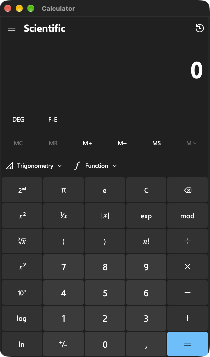 | 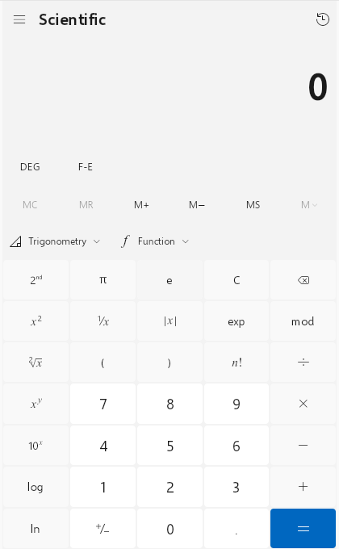 | 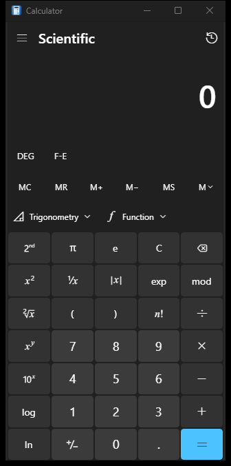 |

The [Microsoft Calculator reference capture](Images/Native/windows-scientific-reference.png) uses version 11.2607.0.0 on the same Windows 11 VM.
Screenshots illustrate layout; they do not establish pixel or mathematical parity.

| Mode | macOS | Linux | Windows |
| --- | --- | --- | --- |
| Programmer | 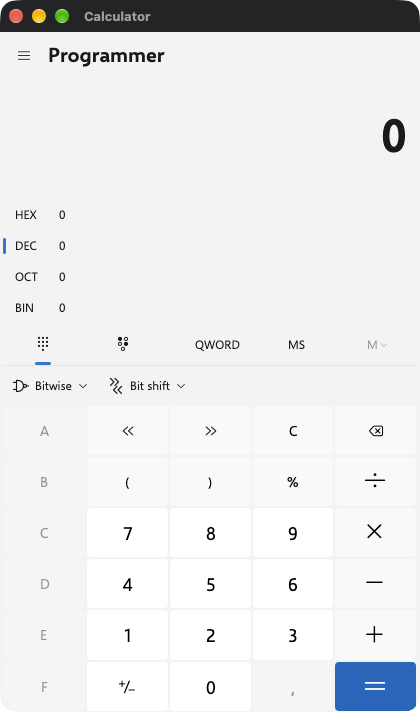 | 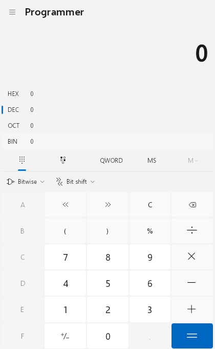 | 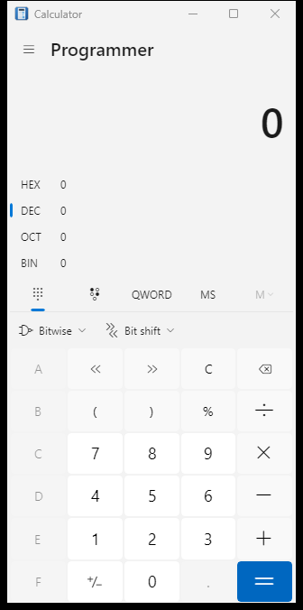 |
| Graphing | 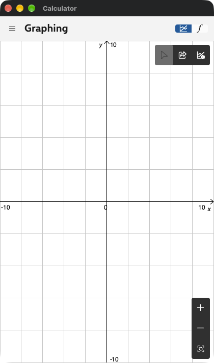 | 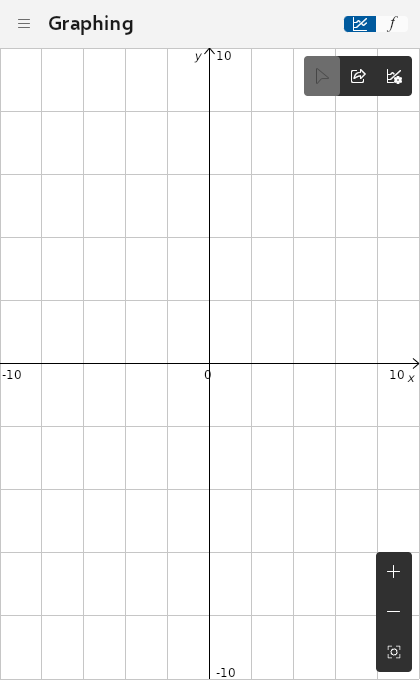 | 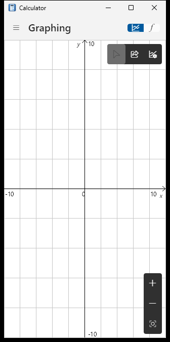 |
| Date calculation | 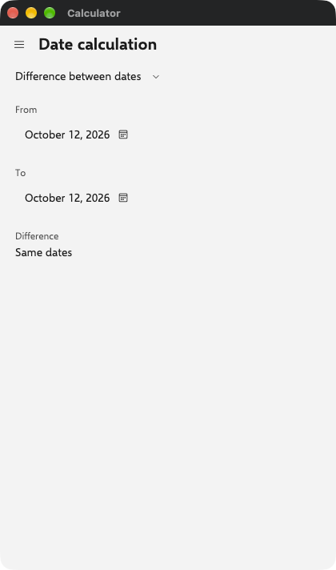 | 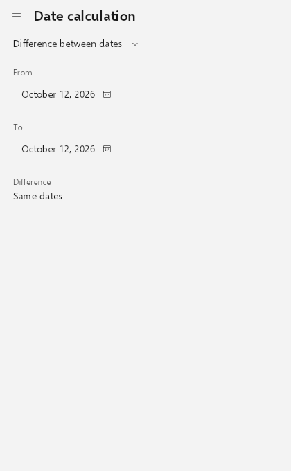 | 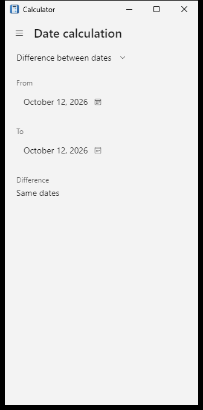 |
| Currency | 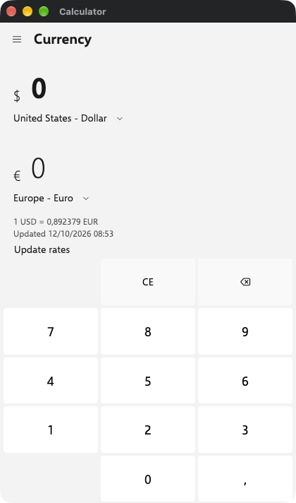 | 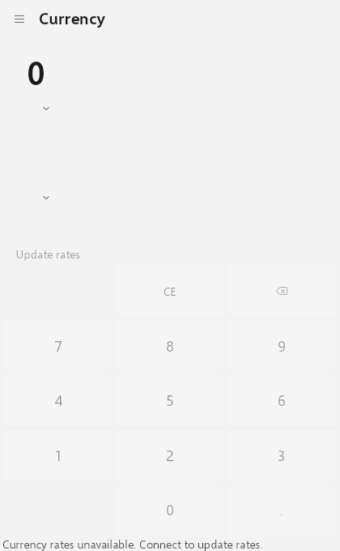 | 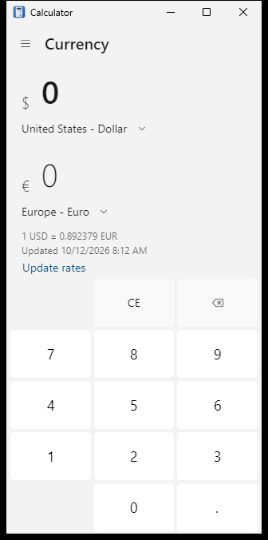 |
| Speed | 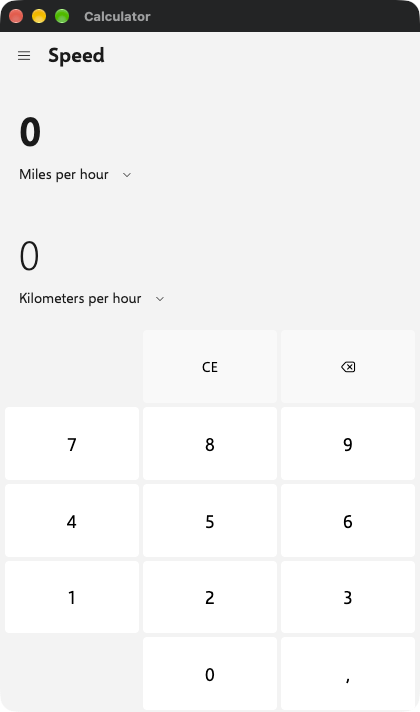 | 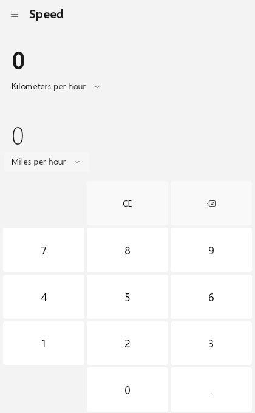 | 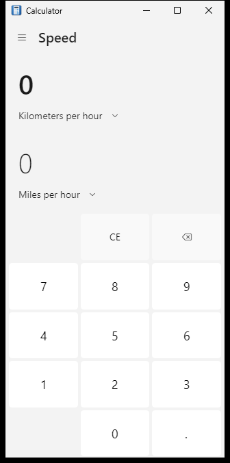 |
| Settings | 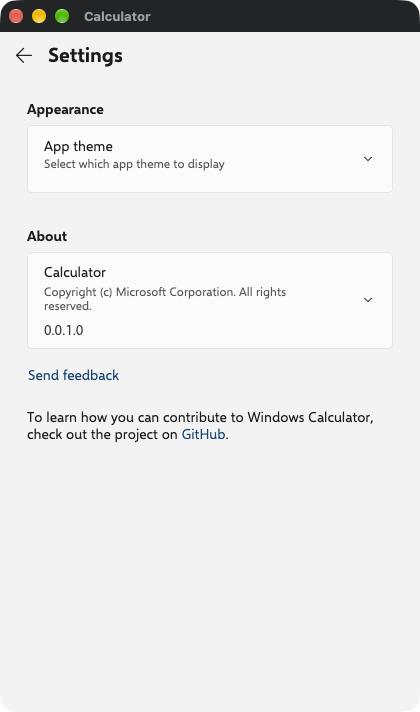 | 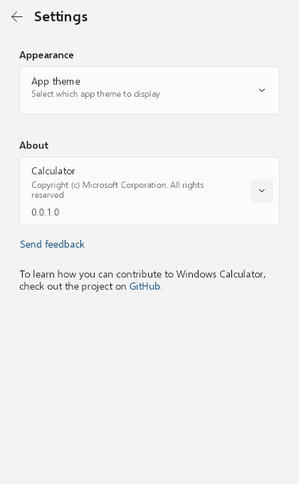 | 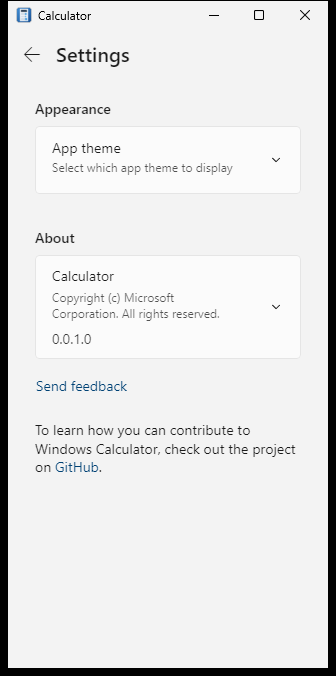 |

[Wide Programmer with its Memory pane](Images/Native/windows-programmer-wide.png) demonstrates the docked layout.
These captures use English labels; numeric/date formatting follows the local region and themes can differ.
The Settings version is the source manifest version, rather than Microsoft's retail package version.

See [application icons](Icons.md) for artwork and regeneration.
